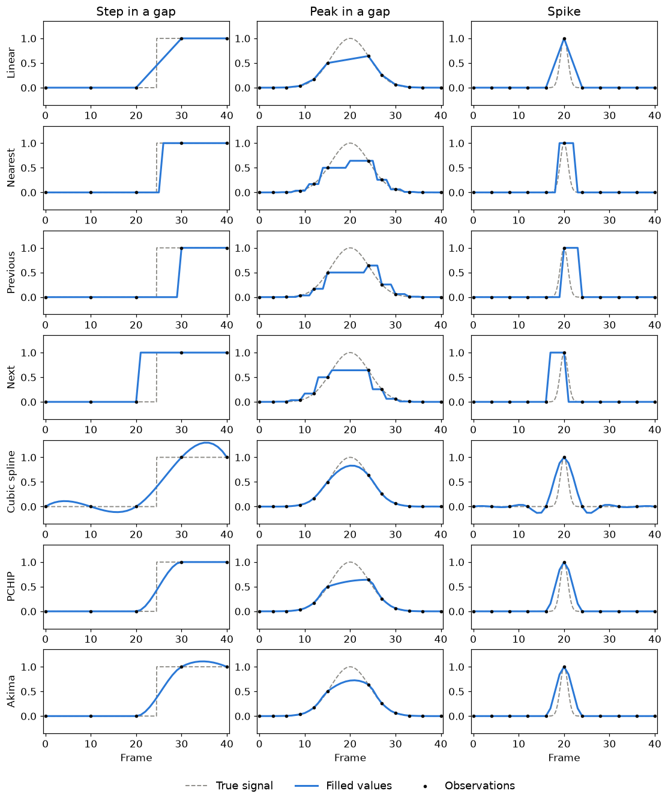

# Interpolation1d

## Overview

Interpolation1d (`interpolation1d`) fills the gaps in a series observed at irregular integer indices, such as frame numbers with dropped frames. Give it the index of each observation and its value, an array of any shape, and it returns a value for every index. Observed values are kept exactly and only the gaps are estimated.

| Method | Class | Smoothness | Overshoot between observations | Minimum observations |
| --- | --- | --- | --- | --- |
| Linear | `LinearInterpolator` | Continuous | None | 2 |
| Nearest | `NearestInterpolator` | Steps | None | 1 |
| Previous | `PreviousInterpolator` | Steps, using only the past | None | 1 |
| Next | `NextInterpolator` | Steps | None | 1 |
| Cubic spline | `CubicSplineInterpolator` | Continuous second derivative | Possible | 2 |
| PCHIP | `PchipInterpolator` | Continuous first derivative | None, and monotonic data stays monotonic | 2 |
| Akima | `AkimaInterpolator` | Continuous first derivative | Mild, and local to outliers | 2 |

Requested indices before the first or after the last observation are filled as `Extrapolation` says: rejected by default, or held, extended by the method, or left as NaN.

Each column below puts every method through one situation: a step and a peak that fall between observations, and a narrow spike on a flat signal.



## Installation

```bash
pip install .
```

## Usage

Fill every index between the first and the last observation:

```python
import numpy as np

from interpolation1d import LinearInterpolator

frames = np.array([0, 1, 4, 5, 9])
positions = np.random.default_rng(0).random((5, 17, 2))  # 17 keypoints per frame

filled = LinearInterpolator().fill(frames, positions)
filled.indices  # [0, 1, ..., 9]
filled.values  # shape (10, 17, 2)
filled.is_observed  # True at frames 0, 1, 4, 5, and 9
```

Fill a wider span, holding the edge values:

```python
from interpolation1d import Extrapolation, PchipInterpolator

filled = PchipInterpolator(extrapolation=Extrapolation.HOLD).fill(
    frames, positions, span=range(0, 12)
)
```

A `range` with a step resamples, here every other index:

```python
filled = LinearInterpolator().fill(frames, positions, span=range(0, 10, 2))
```

## Development

[docs/draw_methods_figure.py](docs/draw_methods_figure.py) redraws the figure above. It declares its own dependencies, including [MatplotlibUtilities](https://github.com/ry-yoshida-dev/MatplotlibUtilities), so the package does not depend on them:

```bash
uv run docs/draw_methods_figure.py
```
